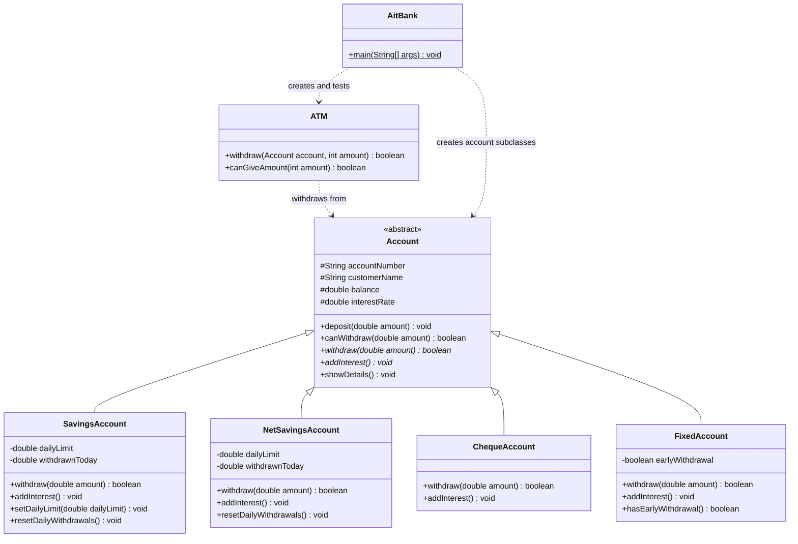

# AITBank Transaction Processing System

AITBank is a beginner-friendly Java project that models deposits, withdrawals,
interest and ATM transactions for four bank account types.

The project focuses only on bank data and business rules. It does not implement
a graphical interface, website or physical ATM interface.

## Account types

### Savings Account

- Earns interest when `addInterest()` is called.
- Has a daily withdrawal limit.
- Allows the customer to change the daily limit.
- Records the total amount withdrawn during the current day.

### Net Savings Account

- Earns interest when `addInterest()` is called.
- Has a daily withdrawal limit.
- Does not allow the customer to change the daily limit.
- Records the total amount withdrawn during the current day.

### Cheque Account

- Does not earn interest.
- Has no daily withdrawal limit.
- A withdrawal is still rejected when the balance is insufficient.

### Fixed Account

- Earns the highest interest rate when no early withdrawal has occurred.
- Every successful withdrawal is considered early for this assignment.
- Once an early withdrawal occurs, `addInterest()` does not add interest.
- Has no daily withdrawal limit.

## ATM rules

The ATM can dispense only `$20`, `$50` and `$100` notes.

The current model assumes that the ATM has an unlimited number of each note.
The ATM checks whether it can produce the requested amount before asking the
account to complete the withdrawal.

Examples:

| Amount | Accepted? | Possible notes |
|---:|:---:|---|
| $20 | Yes | $20 |
| $30 | No | Not possible |
| $40 | Yes | $20 + $20 |
| $50 | Yes | $50 |
| $70 | Yes | $50 + $20 |
| $75 | No | Not possible |
| $100 | Yes | $100 |

## Class structure



In the diagram:

- `+` means `public`.
- `#` means `protected`.
- `-` means `private`.
- `<|--` represents inheritance.
- `..>` represents a dependency.

## Project files

```text
AitBank/
├── pom.xml
├── README.md
└── src/main/java/com/mycompany/aitbank/
    ├── Account.java
    ├── SavingsAccount.java
    ├── NetSavingsAccount.java
    ├── ChequeAccount.java
    ├── FixedAccount.java
    ├── ATM.java
    └── AitBank.java
```

## Important methods

| Method | Purpose |
|---|---|
| `deposit(amount)` | Adds a positive amount to an account. |
| `canWithdraw(amount)` | Checks that an amount is positive and covered by the balance. |
| `withdraw(amount)` | Applies the selected account type's withdrawal rules. |
| `addInterest()` | Applies the selected account type's interest rules. |
| `setDailyLimit(limit)` | Changes a savings account's customer-controlled limit. |
| `resetDailyWithdrawals()` | Clears the amount counted toward today's limit. |
| `hasEarlyWithdrawal()` | Reports whether a fixed account was withdrawn from early. |
| `canGiveAmount(amount)` | Checks whether the ATM can dispense an amount. |

## Running the project in NetBeans

1. Open NetBeans.
2. Select **File > Open Project**.
3. Select the `AitBank` directory.
4. Wait for NetBeans to load the Maven project.
5. Open `AitBank.java`.
6. Click **Run Project**, or press `F6`.
7. Review the account and ATM results in the Output window.

The main class is:

```text
com.mycompany.aitbank.AitBank
```

## Running from a terminal

The Maven configuration targets Java 26. With Maven and JDK 26 installed, run:

```bash
mvn clean compile exec:java
```

Alternatively, compile directly with the JDK:

```bash
mkdir -p out
javac -d out src/main/java/com/mycompany/aitbank/*.java
java -cp out com.mycompany.aitbank.AitBank
```

## Recommended test scenarios

### Common account operations

- Create an account with an opening balance.
- Deposit a positive amount and confirm that the balance increases.
- Try to deposit zero and confirm that the balance does not change.
- Try to deposit a negative amount and confirm that the balance does not change.
- Check a withdrawal smaller than the balance.
- Check a withdrawal equal to the balance.
- Check a withdrawal greater than the balance.
- Check zero and negative withdrawals.
- Call `showDetails()` and inspect the printed information.

### Savings Account

- Make a withdrawal below the daily limit.
- Make several withdrawals whose total exactly reaches the daily limit.
- Attempt another withdrawal after reaching the limit.
- Change the daily limit and test the new value.
- Supply an invalid limit and confirm that it is ignored.
- Reset daily withdrawals and confirm that withdrawals are allowed again.
- Add interest and verify the new balance.
- Attempt to withdraw more than the available balance.

### Net Savings Account

- Make a withdrawal below the fixed daily limit.
- Reach the daily limit using multiple withdrawals.
- Attempt to exceed the daily limit.
- Reset daily withdrawals and try again.
- Add interest and verify the balance.
- Confirm that there is no method for customers to change the limit.

### Cheque Account

- Make multiple withdrawals to demonstrate that there is no daily limit.
- Attempt to withdraw more than the available balance.
- Call `addInterest()` and confirm that the balance does not change.

### Fixed Account

- Add interest before any withdrawal and confirm that it is added.
- Make a successful withdrawal and confirm that `earlyWithdrawal` becomes true.
- Call `addInterest()` after an early withdrawal and confirm that no interest is added.
- Attempt an unsuccessful withdrawal and confirm that it does not set the flag.

### ATM

- Test valid amounts such as `$20`, `$40`, `$50`, `$70`, `$100` and `$110`.
- Test invalid amounts such as `$0`, `$10`, `$30`, `$75` and negative values.
- Complete a valid ATM withdrawal and check the account balance.
- Attempt an amount the ATM cannot dispense and confirm that the balance is unchanged.
- Attempt a dispensable amount above the account balance and confirm that it fails.

## Assumptions

- Interest rates are stored as decimal values. For example, `0.05` means 5%.
- An external date system calls `addInterest()` at the correct time.
- An external date system calls `resetDailyWithdrawals()` at the start of a day.
- Accounts cannot have a negative balance and do not support overdrafts.
- Any successful fixed-account withdrawal is considered early.
- A failed fixed-account withdrawal does not count as early.
- The ATM has an unlimited number of `$20`, `$50` and `$100` notes.
- `double` is used for simplicity. A production banking system should normally
  represent money using `BigDecimal`.

## Possible future improvements

- Replace `double` with `BigDecimal` for monetary values.
- Make account fields private and provide controlled getters or protected helper
  methods.
- Validate constructor arguments such as negative opening balances and rates.
- Track real dates rather than manually resetting daily withdrawals.
- Track the available quantity of each ATM note.
- Add JUnit tests under `src/test/java`.
- Separate console output from the account business logic.

